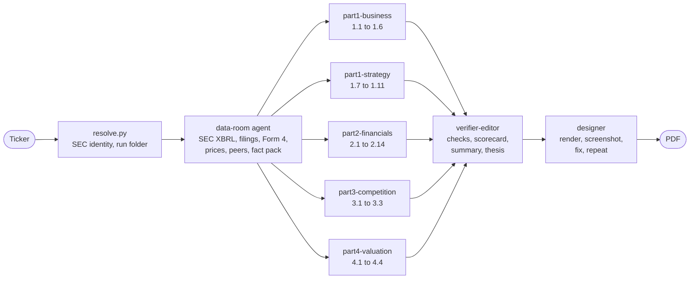

# stock-analysis-teardown

Type a ticker. Get a 30-page equity research deck as a PDF, where every number is either computed from SEC filings or cited to a source.

```
/stock-analysis-teardown MRVL
```

A Claude Code skill. Eight agents split the work the way a small research team would. One gathers the data, five research the company in parallel, one checks every number and writes the verdict, one designs the slides and looks at every page before handing it over.

## What you get

A 16:9 PDF of roughly 30 to 40 slides in a light editorial style, built on a fixed analysis playbook.

| Part | What it answers |
|---|---|
| Executive summary | The verdict in words, three strengths, three risks, five headline numbers, a business quality score |
| 1. The business | How it makes money, segments, moat, industry and market size, pricing power, products, dependencies, management and board, threats, M&A, growth strategy, an overall quality scorecard |
| 2. The numbers | Fourteen financial checks covering growth, mix, margins, operating leverage, earnings quality, cash conversion, working capital, balance sheet, debt, capex, capital allocation, returns on capital, peer benchmarking, takeaways |
| 3. Competitors and owners | Competitive positioning, institutional holders, insider buying and selling, buybacks, regulatory and brand pressure |
| 4. What the price assumes | Multiples against peers and history, a reverse DCF, bear, base and bull scenarios, a sensitivity grid, a valuation football field |
| Thesis | The case in three paragraphs and the signposts that would change the view |
| Appendix | Five-year financial table and every source, numbered and linked. The source pages close the deck with a one-line not-investment-advice note |

The verdict is a few words ("Quality at a full price"), never a Buy or Sell rating. Not every section suits every company, so the deck scales with the company. Each skipped section is listed with a reason.

## Install

You need [Claude Code](https://claude.com/claude-code), Python 3.9 or newer, Node 22 or newer, and Chrome or Chromium.

```bash
git clone https://github.com/geo0apostolakis/stock-analysis-teardown.git
cd stock-analysis-teardown
./install.sh
```

`install.sh` links the skill into `~/.claude/skills/` and installs the renderer's one npm dependency. You can also install it as a plugin from inside Claude Code.

```
/plugin marketplace add geo0apostolakis/stock-analysis-teardown
/plugin install stock-analysis-teardown@stock-analysis-teardown
```

Then run it in any Claude Code session.

```
/stock-analysis-teardown AVGO
/stock-analysis-teardown TSM --peers UMC,INTC,GFS
/stock-analysis-teardown COST --out ~/research
```

## How it works



1. **Resolve.** `resolve.py` turns the ticker into an SEC identity (CIK, legal name, exchange, fiscal year end, 10-K or 20-F filer) and creates a run folder.
2. **Data room.** One agent runs `collect.py`, which pulls five fiscal years and the last eight quarters of XBRL financials, the latest annual report split by Item, the latest 10-Q, the proxy, recent 8-K press releases, Form 4 insider trades, five years of prices, beta and the 10-year Treasury yield. `metrics.py` computes about 250 metrics across every year and quarter. The agent picks the peers, checks the key numbers against the filing text, records what XBRL cannot give (segments, customer concentration, guidance) and writes a fact pack for everyone else.
3. **Five analysts in parallel.** Each owns a slice of the playbook. They read the filings on disk first, then research the web with a deep-research method (search on one engine, cross-check on another, primary sources first, every claim cited and dated). Each writes its slides as JSON and must pass `validate.py` before it is done.
4. **Verifier-editor.** Merges the parts, renumbers and de-duplicates sources, re-checks the claims the thesis depends on against their sources, makes the parts agree, and writes the executive summary, the business quality scorecard, the thesis and the verdict.
5. **Designer.** Renders the deck, screenshots every page, reads the layout QA report, fixes layouts and chart choices, and renders again until the QA report is clean.

### The agents

| Agent | Sections | Reads | Writes |
|---|---|---|---|
| data-room | the evidence base | SEC XBRL, 10-K or 20-F, 10-Q, proxy, 8-Ks, Form 4s, prices | `metrics.json`, `peers.json`, `fact-pack.md` |
| part1-business | 1.1 to 1.6 | Item 1, segment note, transcripts, industry trackers | `parts/part1-business.json` |
| part1-strategy | 1.7 to 1.11 | proxy, risk factors, deal filings, press | `parts/part1-strategy.json` |
| part2-financials | 2.1 to 2.14 | `metrics.json`, MD&A, earnings releases | `parts/part2-financials.json` |
| part3-competition | 3.1 to 3.3 | competitors' filings, holder data, Form 4s | `parts/part3-competition.json` |
| part4-valuation | 4.1 to 4.4 | multiples, guidance, consensus | `valuation_inputs.json`, `parts/part4-valuation.json` |
| verifier-editor | 0.1, 1.12, 5.1 | everything | `deck.json` |
| designer | layout | `deck.json`, screenshots, QA report | the PDF |

Each agent is a plain Markdown brief in `skills/stock-analysis-teardown/agents/`, run as a general-purpose subagent. You can read exactly what each one is told to do.

## Keeping the numbers honest

Hand-built research decks go wrong in predictable ways. A peer's ticker gets attached to the wrong company. A ratio is copied from the row above. An EPS figure lands in the wrong currency. A growth rate gets the wrong sign. This skill is built so those mistakes are hard to make and easy to catch.

- **Computed, not typed.** Every ratio comes from `metrics.py`, from SEC data, with the formula documented in `references/metrics-definitions.md`. Fiscal years are matched by period end date and duration, not by the SEC's calendar frame, so a January year end is labelled correctly. Stock splits are adjusted.
- **Tokens instead of numbers.** Slides say `{{m:revenue@FY2026|money}}` and `prepare.py` fills in `$8.19B` at render time from the one formatter. A token cannot be mistyped and cannot drift from the data. An unknown token stops the build.
- **Every other number is cited or labelled.** `check_numbers.py` finds each hand-typed number. It must carry a source reference, or be marked as the teardown's own estimate. If it matches a computed metric, the checker asks for the token instead.
- **ADRs and currencies.** For a foreign company the scripts read how many shares one ADS stands for straight from its 20-F and convert the accounts into the price currency, so a P/E is never a Taiwan-dollar profit set against a US-dollar price. If the ratio cannot be found, or the result is implausible (a market cap above any listed company), the run warns before anyone writes a slide.
- **Tickers are checked.** "Name (TICKER)" pairs are matched against the SEC ticker list and the peer table.
- **Peer sanity.** Identical values across two peers are flagged as a likely copy error. Impossible margins fail the build.
- **Insiders are the company's own.** Form 4s where the company itself is the owner of some other company's stock are left out, so a stake sale in a bottler or a supplier does not show up as insider selling.
- **Coverage is checked.** `validate.py` fails a deck that leaves a core section of the playbook uncovered, and needs a reason for every optional one that is skipped.

## Design

Light editorial. Off-white paper, near-black ink, one blue accent with orange and green for second and third series, Source Serif 4 for titles and Inter with tabular figures for numbers. Both fonts are embedded (SIL Open Font License).

Charts follow a data-visualisation method with rules that can be checked. One y-axis per chart, thin bars with rounded data ends, the company highlighted and peers in grey, a palette checked for colour-blind separation and contrast against the paper, and value labels where a printed page has no hover. Chart kinds include bars, stacked and 100% bars, lines, areas, ranked bars, waterfalls, an income statement Sankey, peer scatter plots, a debt maturity ladder, a price chart with numbered events and a valuation football field.

The renderer builds one HTML page, opens it in headless Chrome over the DevTools protocol (no Puppeteer or Playwright), draws every chart as SVG with ECharts at its measured size, runs a layout QA pass and prints the PDF. QA catches overflowing or clipped text, titles that run past two lines, charts squeezed too small and chart labels that collide. It also writes a screenshot of every slide and a contact sheet, which is what the designer agent looks at.

## Run folder

Every run is a self-contained folder you can inspect or resume.

```
MRVL-2026-11-02/
  run.json              identity, as-of date, which phases are done
  data/                 SEC and market data, metrics.json, peers.json, valuation.json, fact-pack.md, filings/
  notes/<agent>/        research logs with sources
  parts/<agent>.json    each analyst's slides
  deck.json             the finished deck
  build/                QA reports, deck.html, screenshots
  MRVL-teardown-2026-11-02.pdf
```

If a run stops halfway, run the same command again and it resumes from the first unfinished phase.

## Configuration

| Variable | Default | Purpose |
|---|---|---|
| `SEC_USER_AGENT` | `stock-analysis-teardown research@example.com` | SEC asks every client to identify itself. Set your name and email. |
| `TEARDOWN_OUTPUT_DIR` | `./teardowns` | Where run folders go |
| `CHROME_PATH` | auto-detected | Chrome or Chromium binary for rendering |

Web research uses the Exa and Parallel search tools when they are installed in Claude Code, and the built-in WebSearch and WebFetch otherwise.

## Using the pieces on their own

The scripts work without the agents, which is handy for checking a number or re-rendering after an edit.

```bash
S=~/.claude/skills/stock-analysis-teardown/scripts
RUN=$(python3 $S/resolve.py NVDA | tail -1)
python3 $S/collect.py $RUN --peers AMD,AVGO,INTC   # data, metrics, peer table (about 20 seconds)
python3 $S/metrics.py list $RUN margin              # every margin it computed
python3 $S/valuation.py init $RUN && python3 $S/valuation.py run $RUN
python3 $S/validate.py $RUN                          # structure, coverage, numbers, writing
python3 $S/prepare.py $RUN && node $S/../renderer/render.mjs $RUN
```

`schema/example-deck.json` shows every layout and chart kind, and `references/slide-layouts.md` documents them.

## Time and cost

A full run takes roughly 30 to 60 minutes and uses a lot of tokens, because five agents research the web at the same time and each reads long filings. The data layer alone takes under a minute and costs nothing. Rendering takes a few seconds.

## Limitations

- Financial data comes from SEC XBRL, so US-listed companies and foreign companies that file 10-Ks or 20-Fs get the best results. Other companies work, but their statements are entered from annual reports and the deck says the data confidence is lower.
- Foreign filers (20-F) report once a year in XBRL, so their trailing twelve months is the last full fiscal year. Later quarters come from their 6-K releases, entered by the data-room agent with a source.
- XBRL is occasionally wrong or late (a 20-F can appear weeks after filing). The data-room agent checks key numbers against the filing text and the scripts warn about missing filings, but read the data caveats in the fact pack.
- Market data comes from Yahoo Finance's public chart endpoint, which can change without notice.
- Web research quality depends on what is public. Market share and survey data are often behind paywalls; the deck says so instead of guessing.
- The valuation is a model with stated assumptions. Change the assumptions and the values change.

## Not investment advice

The decks this skill produces are research for education and discussion. They are not investment advice and not a recommendation to buy or sell any security. Check the sources and do your own work before you invest.

## License

MIT. Fonts are Inter and Source Serif 4 under the SIL Open Font License 1.1 (see `skills/stock-analysis-teardown/renderer/fonts/`). ECharts is Apache 2.0.
